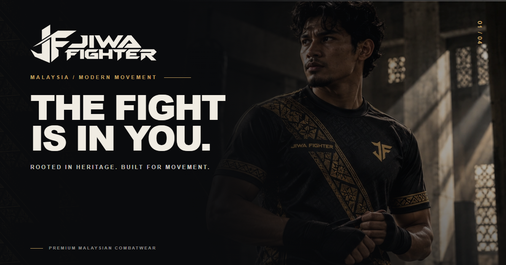

<div align="center">
  <h1>JIWA FIGHTER</h1>
  <p><strong>Contemporary Martial Arts & Silat Combat Apparel Brand Experience</strong></p>
  <p>
    <a href="https://jiwa-fighter.vercel.app"></a>
    <a href="https://github.com/syahmiaof/jiwa-fighter"></a>
    <a href="LICENSE"></a>
    <a href="https://syahmiaof.my"></a>
  </p>

  

  <br/><br/>

  <p><strong>Contemporary combat sportswear and martial arts lifestyle storefront prototype rooted in traditional Nusantara silat heritage.</strong></p>

  <p><a href="https://jiwa-fighter.vercel.app">Live Experience</a> • <a href="#-project-overview">Overview</a> • <a href="#-core-features--route-inventory">Routes</a> • <a href="#-tech-stack">Tech Stack</a> • <a href="#%EF%B8%8F-architecture--shared-systems">Architecture</a></p>
</div>

---

## 💎 Project Overview

- **Functionality**: Next.js 14 App Router e-commerce prototype delivering 9 fully responsive routes, interactive slide-over cart with LocalStorage persistence, and instant client-side bilingual (EN/BM) dictionary switching.
- **Aesthetic Value**: Editorial martial arts typography, songket heritage motifs, chiaroscuro brass-and-obsidian palette, and choreographed GSAP 3 / ScrollTrigger page reveals.
- **Business Value**: Demonstrates scalable modular design system architecture, accessible reduced-motion UX, and high-conversion tactical retail user journeys.

---

## ✨ Core Features & Route Inventory

The platform delivers 9 complete, responsive application routes built on the Next.js 14 App Router:

| Route | Page | Theme & Purpose |
|---|---|---|
| `/` | **Homepage** | *"The Fight Is In You"* — Cinematic hero reveal, brand manifesto, featured collections, and visual lookbook teaser. |
| `/shop` | **Shop All** | *"The Uniform of the Unbroken"* — Filterable product catalog with category switching, sort controls, and quick-add to bag. |
| `/collections/silat-series` | **Silat Series** | *"The Art of Defence"* — Dedicated collection landing highlighting tactical apparel and technical garments. |
| `/products/keris-tuah` | **Product Detail** | *"Keris Tuah"* — Rich product showcase with multi-angle gallery, size selection, accordion specs, and cart drawer. |
| `/lookbook` | **Lookbook** | *"A Legacy in Motion"* — Editorial martial arts photography, typography compositions, and motion reels. |
| `/our-story` | **Our Story** | *"Not Born to Stand Still"* — Heritage narrative detailing the philosophical bridge between ancestral combat and modern athletics. |
| `/custom` | **Teamwear & Custom** | *"Your Crew. One Jiwa."* — Interactive team quote builder, volume discount tiers, and custom uniform inquiries. |
| `/size-guide` | **Size & Fit Guide** | *"Built to Move With You"* — Dynamic measurement calculators, fit guides, and international conversion charts. |
| `/support` | **Customer Care** | *"We're in Your Corner"* — FAQ accordion, shipping information, care guides, and support contact form. |

---

## 🛠️ Architecture & Shared Systems

- **Motion Engine (`src/lib/motion/`):**
  - Powered by **GSAP 3.12.5** and `@gsap/react` with custom ScrollTrigger choreography.
  - "Disciplined Force" motion identity: `useHeroReveal`, `useScrollReveal`, and `useStaggerCards`.
  - Accessible `prefers-reduced-motion` detection and graceful degradation.
- **Bilingual Internationalization (`src/lib/i18n/`):**
  - Instantaneous client-side language toggle between **English** and **Bahasa Melayu** across all 9 pages.
  - Type-safe dictionary covering headers, body copy, product specs, and button states.
- **Client-Side Commerce Simulation (`src/lib/cart/`):**
  - Interactive slide-over cart drawer with variant picking, item quantity adjustments, and subtotal calculation.
  - LocalStorage persistence preserving bag contents between sessions.
  - Safe prototype checkout dialog.

---

## 💻 Tech Stack

<p align="center">
  
  
  
  
  
  
  
</p>

---

## 📁 Repository Structure

```text
jiwa-fighter/
├── docs/                     # Design systems, architectural audit logs, and reports
│   └── mockups/              # High-resolution design mockups & brand asset exports
├── public/                   # Static web assets, logos, and opengraph banners
├── src/
│   ├── app/                  # Next.js 14 App Router pages (9 complete routes)
│   ├── components/           # Reusable UI components, layout headers, footers, cart drawer
│   ├── lib/                  # Motion hooks, i18n dictionaries, and cart context
│   └── styles/               # Global typography and Tailwind stylesheets
├── .github/workflows/        # Automated GitHub Actions CI workflow
├── LICENSE                   # Proprietary All Rights Reserved License
└── package.json
```

---

## 👑 Builder

**Muhammad Syahmi (syahmiaof)**  
- Portfolio: [syahmiaof.my](https://syahmiaof.my)  
- GitHub: [@syahmiaof](https://github.com/syahmiaof)  
- Live Showcase: [jiwa-fighter.vercel.app](https://jiwa-fighter.vercel.app)
